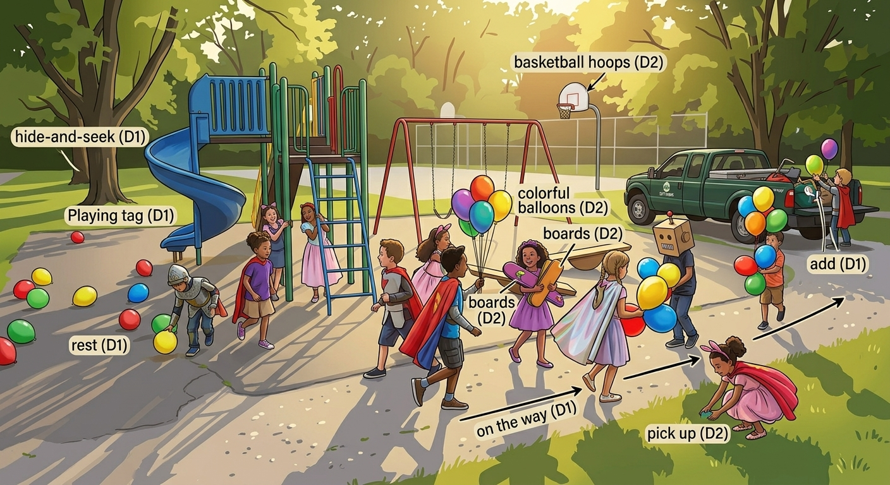
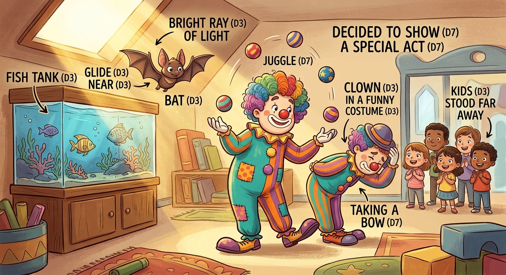
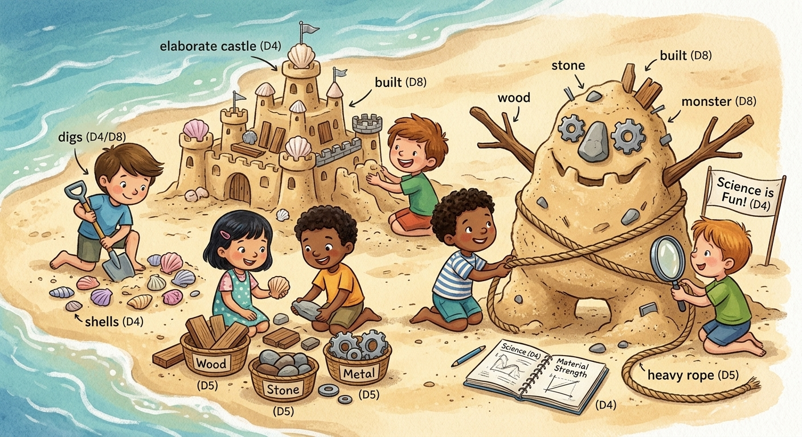
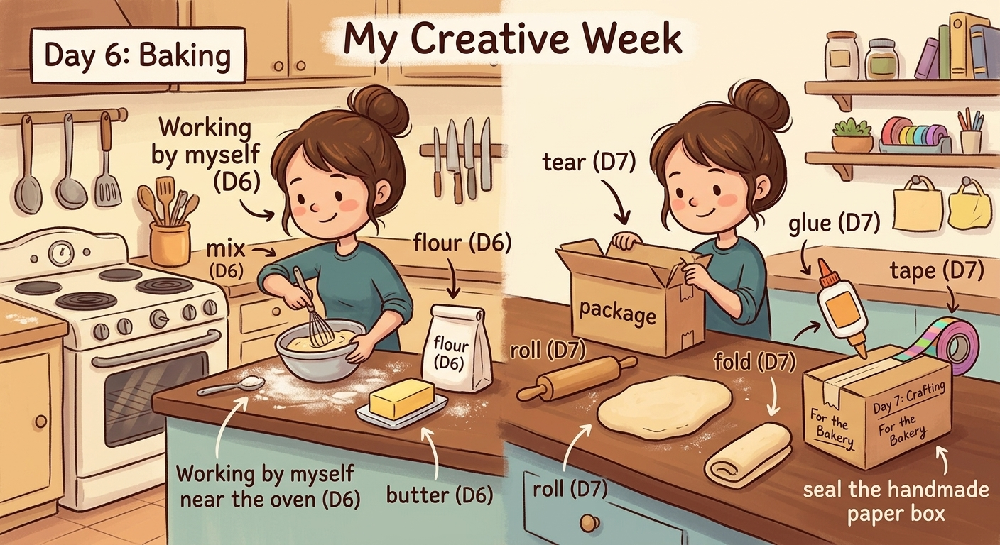

# Story 001 — Miller's Amazing Day

Read each scene aloud once with the word labels visible. Then cover the labels and retell the scene from the picture.

## Scene 1 — The playground

On the **way** to the playground, Miller wears a silly **dress** and plays **tag** and **hide-and-seek**. His friends **pick up** the **rest** of the **balloons** and **add** them to their toy **trucks**.

They ran **near** the **slides**, balanced on the **boards**, and shot **hoops**.

## Scene 2 — The clown show

**Far** across the room, a **bat** began to **glide** **near** a fish **tank** under a bright **ray** of light.

A **clown** in a funny **costume** began to **juggle**. He decided to **show** us a silly **act**, and then he took a **bow**.

## Scene 3 — The beach workshop

At the beach, the children use **science** to **dig** for **shells** and **build** sand **castles**.

They **build** a monster from **wood**, **stone**, and **metal**, tie it with **rope**, and place it beside the castles. Their newly **built** monster looks funny but friendly.

## Scene 4 — Baking and making

By **myself**, I **mix** **flour** and **butter** near the **oven**, then **roll** out the dough and **fold** it over.

Finally, I **tear** a sheet of paper, **fold** it into a box, and use **glue** and **tape** to hold it together.

## Recall activities

1. Miller points to five objects in the picture and says the English words.
2. Hide the labels. Miller retells each scene using his own words.
3. Ask one meaning question: “What does **pick up** mean here?”
4. Ask one use question: “Can you make a new sentence with **add**?”
5. At the end, Miller chooses three words to draw or act out.

## Parent check

- Can Miller recognize the word when he sees it?
- Can he explain or demonstrate the meaning?
- Can he say it clearly enough to be understood?
- Can he use it in a new sentence the next day?
