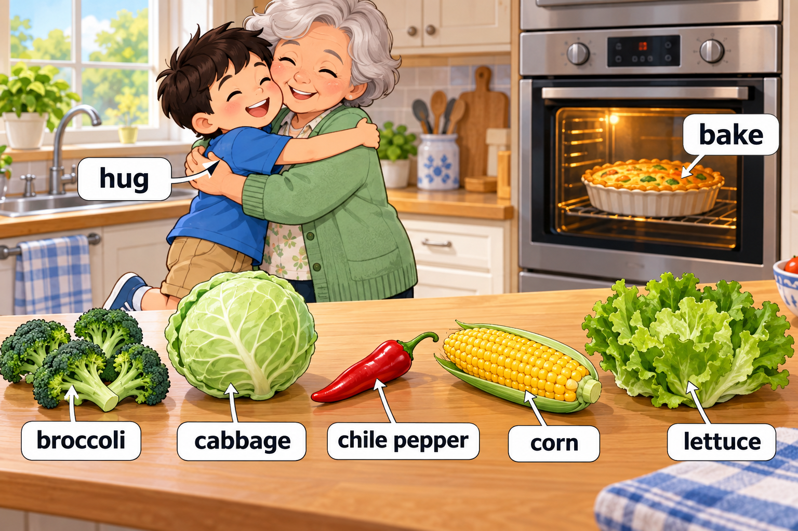
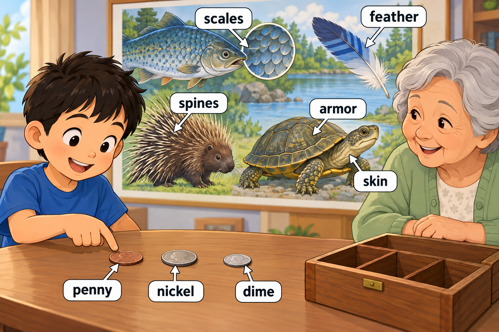
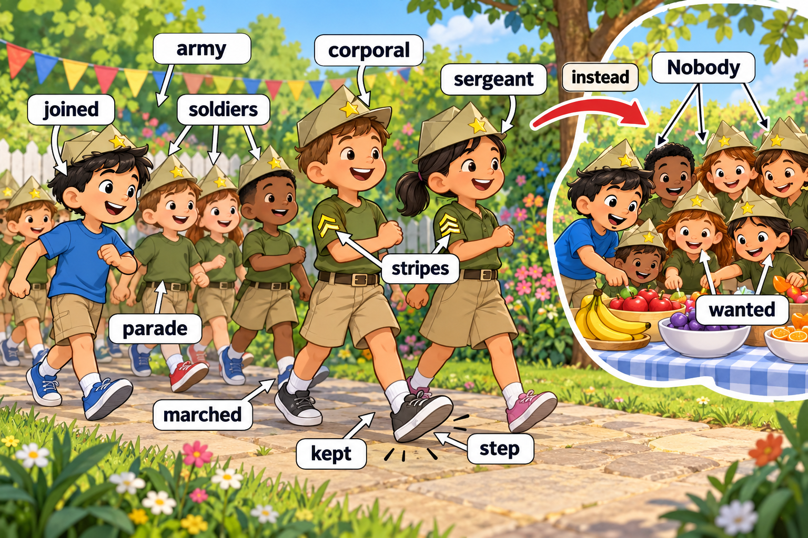
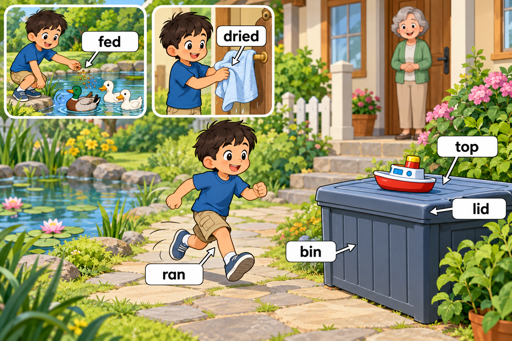
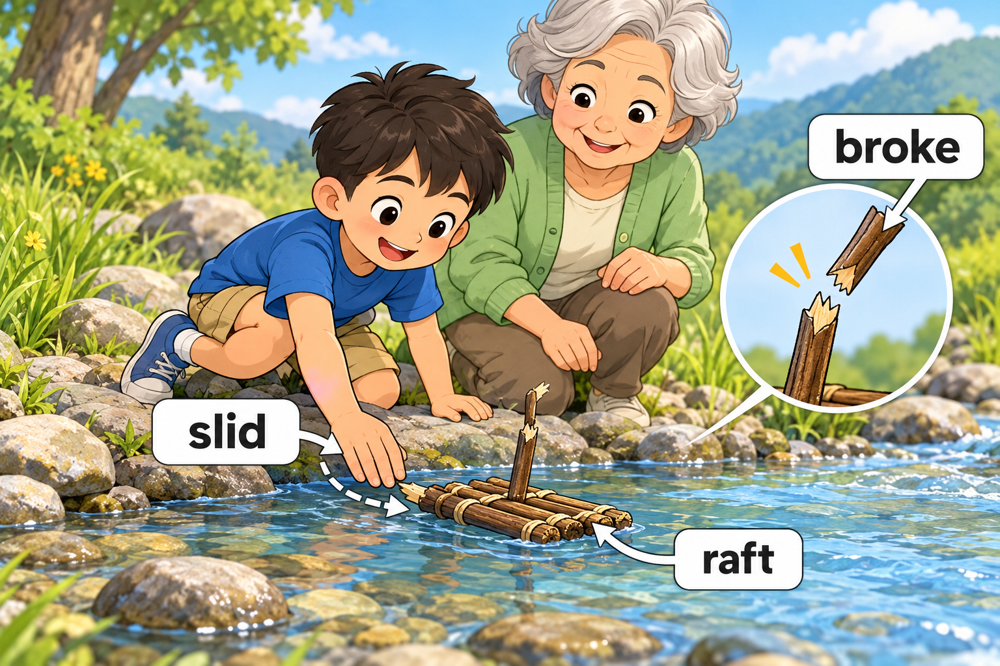

# Story 002 — Miller's Busy Saturday

中文标题：Miller 忙碌的星期六

范围：**第 2 周 · Day 9–14** · 37 个目标词 · 5 个场景。周次依据见 [words.md](../words.md)。

先读英文，再用中文核对。每次练习约 5–8 个词，词少的场景可以合并，词多的场景分两次；读完后遮住句子，用动作或自己的话复述。

## Scene 1 — A kitchen hug

场景：厨房里的拥抱 · 单词来源：Day 9

Miller gave Grandma a **hug** before helping her **bake** a pie.

They put **broccoli** and **cabbage** in the pie.

There was a **chile pepper** beside the **corn** and **lettuce** on the table.

中文解释：Miller 抱了抱奶奶，然后帮她烤馅饼。馅饼里放了西兰花和甘蓝菜，桌上还有辣椒、玉米和生菜。

Words used: hug, bake, broccoli, cabbage, chile pepper, corn, lettuce.

## Scene 2 — Coins and a nature poster

场景：硬币和动物海报 · 单词来源：Day 10

In Grandma's coin box, Miller found a **penny**, a **nickel**, and a **dime**.

On a nature poster, a fish had shiny **scales**, a bird had a soft **feather**, and a porcupine had sharp **spines**.

A turtle's shell looked like **armor**, covering the soft **skin** underneath.

中文解释：Miller 在奶奶的硬币盒里找到了三种硬币。动物海报上的鱼鳞闪闪发亮，鸟有柔软的羽毛，豪猪有尖刺。乌龟的壳像盔甲，保护着下面柔软的皮肤。

Words used: penny, nickel, dime, scales, feather, spines, armor, skin.

## Scene 3 — A pretend parade

场景：游戏里的游行 · 单词来源：Day 11

Miller **joined** a pretend **army**, and the **soldiers** **marched** in a **parade**.

The **corporal** and **sergeant** wore **stripes** on their sleeves and **kept** in **step**.

**Nobody** **wanted** to stop, but it was time for a snack **instead**.

中文解释：Miller 加入了扮演军队的游戏，大家扮成士兵参加游行。下士和军士的袖子上有条纹，他们步伐一致。虽然没人想停下来，但大家该改为吃点心了。

Words used: joined, army, soldiers, marched, parade, corporal, sergeant, stripes, kept, step, Nobody, wanted, instead.

## Scene 4 — A boat on the lid

场景：盖子上的小船 · 单词来源：Day 12、Day 13

Back home, Miller **fed** the ducks and **dried** his hands.

Then he **ran** to the toy **bin**.

A little boat sat on **top** of the bin's **lid**.

中文解释：回到家，Miller 喂了鸭子并擦干双手。他跑到玩具箱旁，发现一只小船放在箱子盖的上面。

Words used: fed, dried, ran, bin, top, lid.

## Scene 5 — The little raft

场景：小木筏 · 单词来源：Day 14

Miller took his toy **raft** to a little stream.

He **slid** it into the water, but a twig on the raft **broke**.

Grandma helped him fix it, and the raft floated again.

中文解释：Miller 带着玩具木筏来到小溪边，把它轻轻滑入水中。木筏上的小树枝断了，奶奶帮忙修好后，它又漂了起来。

Words used: raft, slid, broke.

## Coverage check

按原词表的 Day 和当天序号逐项核对；英文大小写按句子位置调整。

| Week | Day | 当天序号 | 词表单词 | 场景 |
| --- | --- | --- | --- | --- |
| 第 2 周 | 9 | 1 | bake | Scene 1 |
| 第 2 周 | 9 | 2 | hug | Scene 1 |
| 第 2 周 | 9 | 3 | broccoli | Scene 1 |
| 第 2 周 | 9 | 4 | lettuce | Scene 1 |
| 第 2 周 | 9 | 5 | corn | Scene 1 |
| 第 2 周 | 9 | 6 | chile pepper | Scene 1 |
| 第 2 周 | 9 | 7 | cabbage | Scene 1 |
| 第 2 周 | 10 | 1 | Penny | Scene 2 |
| 第 2 周 | 10 | 2 | nickel | Scene 2 |
| 第 2 周 | 10 | 3 | dime | Scene 2 |
| 第 2 周 | 10 | 4 | Scales | Scene 2 |
| 第 2 周 | 10 | 5 | feather | Scene 2 |
| 第 2 周 | 10 | 6 | spines | Scene 2 |
| 第 2 周 | 10 | 7 | armor | Scene 2 |
| 第 2 周 | 10 | 8 | skin | Scene 2 |
| 第 2 周 | 11 | 1 | joined | Scene 3 |
| 第 2 周 | 11 | 2 | army | Scene 3 |
| 第 2 周 | 11 | 3 | nobody | Scene 3 |
| 第 2 周 | 11 | 4 | soldiers | Scene 3 |
| 第 2 周 | 11 | 5 | marched | Scene 3 |
| 第 2 周 | 11 | 6 | Parade | Scene 3 |
| 第 2 周 | 11 | 7 | kept | Scene 3 |
| 第 2 周 | 11 | 8 | step | Scene 3 |
| 第 2 周 | 11 | 9 | stripes | Scene 3 |
| 第 2 周 | 11 | 10 | corporal | Scene 3 |
| 第 2 周 | 11 | 11 | sergeant | Scene 3 |
| 第 2 周 | 11 | 12 | wanted | Scene 3 |
| 第 2 周 | 11 | 13 | instead | Scene 3 |
| 第 2 周 | 12 | 1 | fed | Scene 4 |
| 第 2 周 | 12 | 2 | dried | Scene 4 |
| 第 2 周 | 12 | 3 | top | Scene 4 |
| 第 2 周 | 13 | 1 | bin | Scene 4 |
| 第 2 周 | 13 | 2 | lid | Scene 4 |
| 第 2 周 | 13 | 3 | ran | Scene 4 |
| 第 2 周 | 14 | 1 | raft | Scene 5 |
| 第 2 周 | 14 | 2 | slid | Scene 5 |
| 第 2 周 | 14 | 3 | broke | Scene 5 |

覆盖结果：37/37 个目标词全部出现。本周没有跨 Day 重复的目标条目；句中为叙事而重复使用的词不新增计数。

## Meaning and language notes

- scales：用户已确认释义为“鳞片”，本场景恢复第一版的鱼鳞配图和英文句子。Scene 3 的 stripes 指袖子上的条纹。
- penny、nickel、dime：场景只辨认硬币，不计算币值；penny 在英国可指便士，在美国可指一美分硬币。
- kept in step：保持步伐一致；instead：改做另一件事。
- bin：这里是玩具箱；top of its lid：盖子的上面。
- 词表中的 Penny、Scales、Parade 在句中按普通名词写为 penny、scales、parade。

## Recall activities

1. What is on the table?（说出两种蔬菜。）
2. Can you march in step?（边踏步边说 kept in step。）
3. What happened to the raft?（用 slid 和 broke 复述最后一个场景。）

4. 选两个目标词，各造一个与 Miller 自己生活有关的新句子。
5. 首次练习后第 1、3、7、14 天复习，先回忆再看答案；在 [review-log.md](review-log.md) 中记录。
