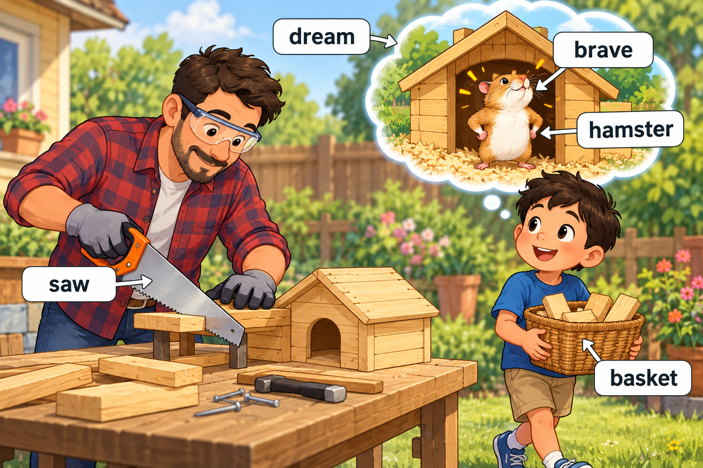
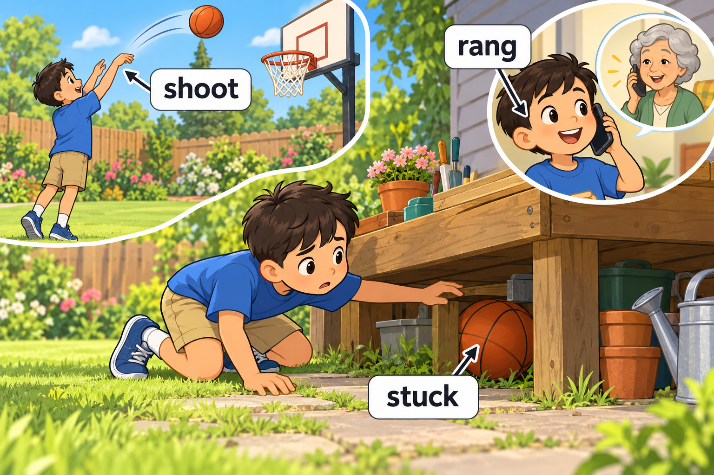
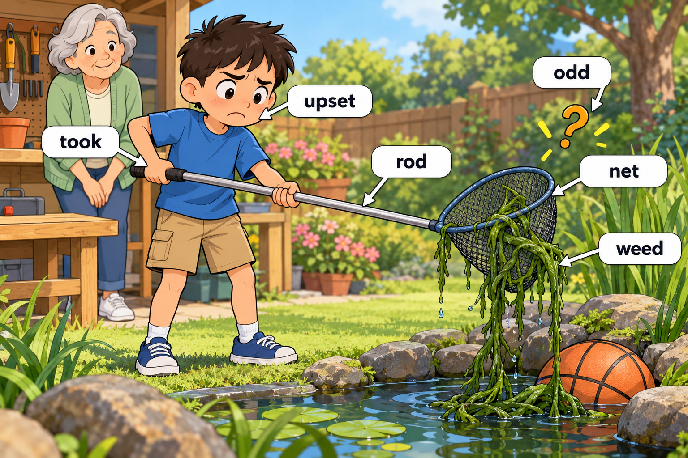
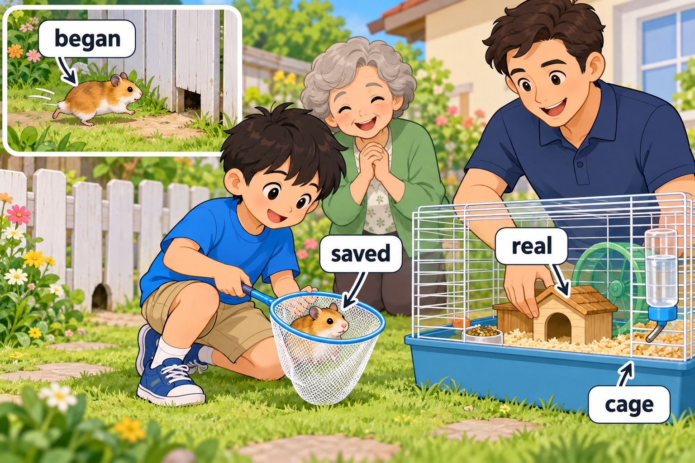

# Story 003 — A Little House for a Hamster

中文标题：给仓鼠的小房子

范围：**第 3 周（推定） · Day 15–20** · 18 个目标词 · 4 个场景。周次依据见 [words.md](../words.md)。

先读英文，再用中文核对。每次练习约 5–8 个词，词少的场景可以合并，词多的场景分两次；读完后遮住句子，用动作或自己的话复述。

## Scene 1 — A dream house

场景：梦里的小房子 · 单词来源：Day 15、Day 20

Miller had a **dream** about a **brave** **hamster** in a tiny house.

In the morning, Dad used a **saw** to build that house.

Miller carried the pieces in a **basket**.

中文解释：Miller 梦见一只勇敢的仓鼠住在小房子里。早上，爸爸用锯子做这间房子，Miller 用篮子搬木块。

Words used: dream, brave, hamster, saw, basket.

## Scene 2 — A stuck basketball

场景：卡住的篮球 · 单词来源：Day 16

During a break, Miller tried to **shoot** a basketball into the hoop.

The ball got **stuck** under the garden workbench.

He **rang** Grandma to tell her about it.

中文解释：休息时，Miller 想投篮，但球卡在花园的工作台下面。他给奶奶打了电话，告诉她这件事。

Words used: shoot, stuck, rang.

## Scene 3 — An odd little problem

场景：一个古怪的小麻烦 · 单词来源：Day 17、Day 18

Miller **took** a long **rod** and a **net** to fetch the ball.

A long **weed** was tangled in the net, and Miller felt **upset**.

“That is **odd**!” he said.

中文解释：Miller 拿来一根长竿和一个网，想取出篮球。网里缠着一株长长的杂草，让他有点心烦。他说：“真奇怪！”

Words used: took, rod, net, weed, upset, odd.

## Scene 4 — Home at last

场景：终于回家了 · 单词来源：Day 19、Day 20

Just then, the hamster **began** to run toward a hole in the fence.

Miller shook the weed loose and **saved** the hamster with the net.

They put its **real** little house inside the **cage**.

中文解释：这时，仓鼠开始向栅栏上的洞跑去。Miller 抖掉网里的杂草，用网把仓鼠救了回来。最后，他们把真正做好的小房子放进笼子里。

Words used: began, saved, real, cage.

## Coverage check

按原词表的 Day 和当天序号逐项核对；英文大小写按句子位置调整。

| Week | Day | 当天序号 | 词表单词 | 场景 |
| --- | --- | --- | --- | --- |
| 第 3 周（推定） | 15 | 1 | brave | Scene 1 |
| 第 3 周（推定） | 15 | 2 | saw | Scene 1 |
| 第 3 周（推定） | 15 | 3 | dream | Scene 1 |
| 第 3 周（推定） | 16 | 1 | shoot | Scene 2 |
| 第 3 周（推定） | 16 | 2 | stuck | Scene 2 |
| 第 3 周（推定） | 16 | 3 | rang | Scene 2 |
| 第 3 周（推定） | 17 | 1 | rod | Scene 3 |
| 第 3 周（推定） | 17 | 2 | net | Scene 3 |
| 第 3 周（推定） | 17 | 3 | weed | Scene 3 |
| 第 3 周（推定） | 18 | 1 | took | Scene 3 |
| 第 3 周（推定） | 18 | 2 | odd | Scene 3 |
| 第 3 周（推定） | 18 | 3 | upset | Scene 3 |
| 第 3 周（推定） | 19 | 1 | began | Scene 4 |
| 第 3 周（推定） | 19 | 2 | real | Scene 4 |
| 第 3 周（推定） | 19 | 3 | Saved | Scene 4 |
| 第 3 周（推定） | 20 | 1 | hamster | Scene 1 |
| 第 3 周（推定） | 20 | 2 | cage | Scene 4 |
| 第 3 周（推定） | 20 | 3 | basket | Scene 1 |

覆盖结果：18/18 个目标词全部出现。本周没有跨 Day 重复的目标条目；句中为叙事而重复使用的词不新增计数。

## Meaning and language notes

- saw：这里是工具“锯子”；dream：这里是睡觉时做的梦。
- shoot a basketball：投篮；shoot 在这里不用射击的意思。
- rang Grandma：给奶奶打了电话；和 the phone rang（电话铃响了）区分。
- saved：这里是救回仓鼠；不是保存文件或节省钱。词表中的 Saved 在句中写作 saved。
- upset：故事采用“心烦；难过”，将照片中的中文重复字整理为自然表达。

## Recall activities

1. What got stuck?（用 The ball got stuck 回答。）
2. How did Miller save the hamster?（说出 net，并复述救回仓鼠的动作。）
3. What was in the cage?（区分梦里的房子和 real little house。）

4. 选两个目标词，各造一个与 Miller 自己生活有关的新句子。
5. 首次练习后第 1、3、7、14 天复习，先回忆再看答案；在 [review-log.md](review-log.md) 中记录。
