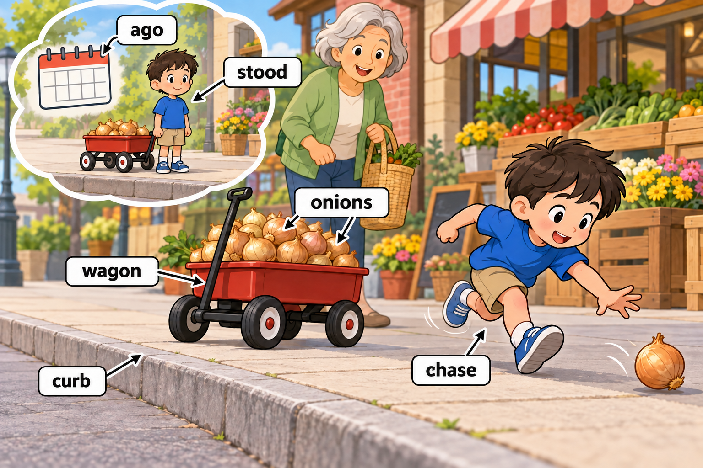
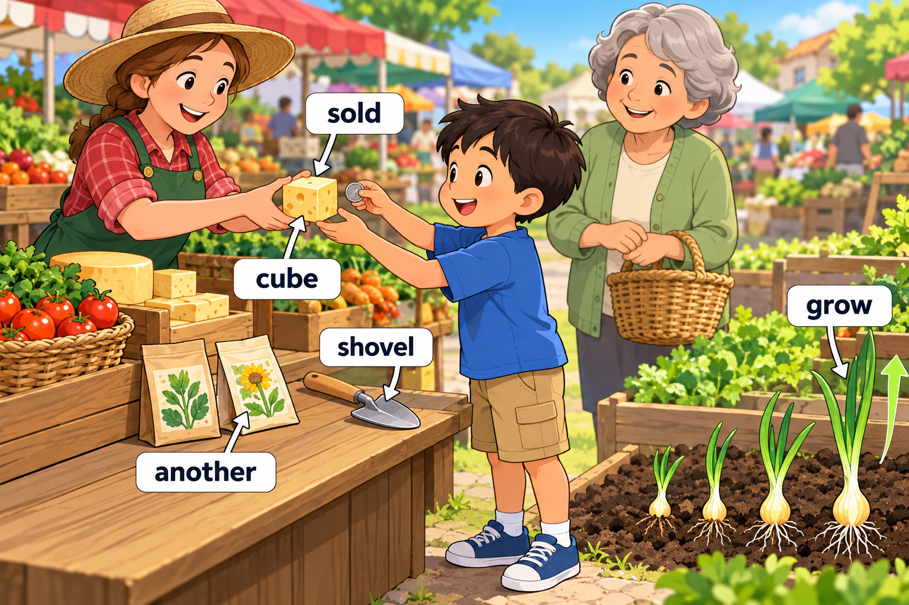
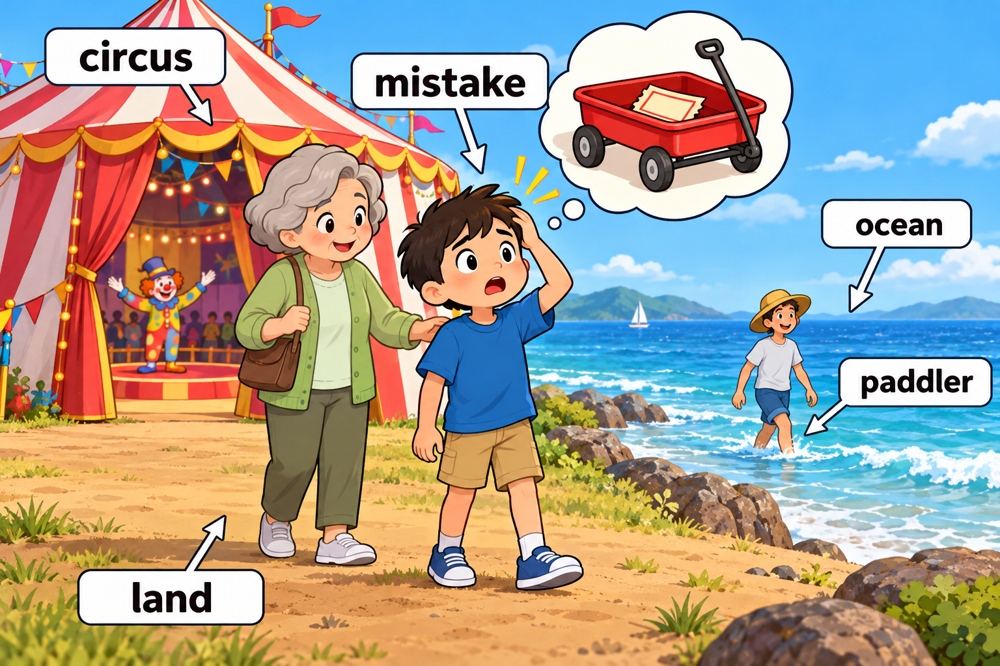
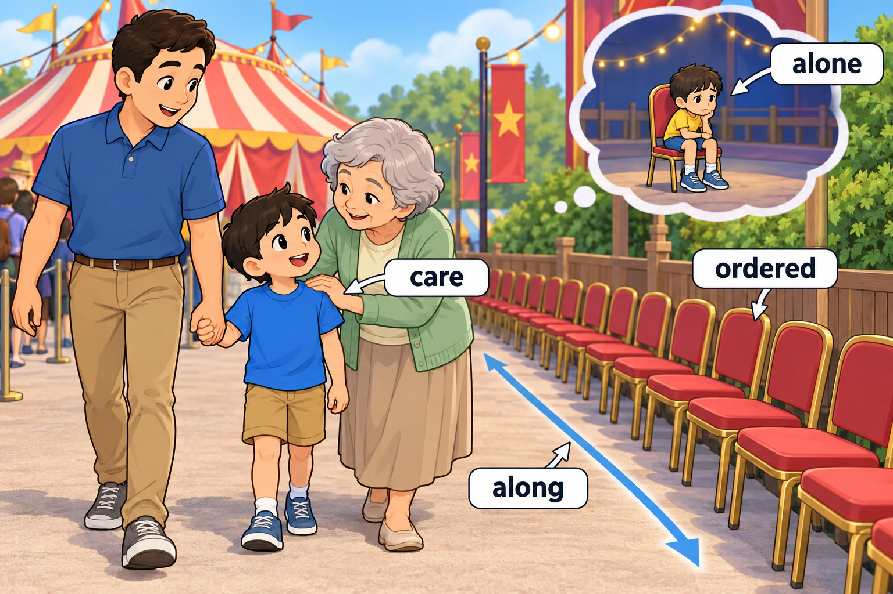
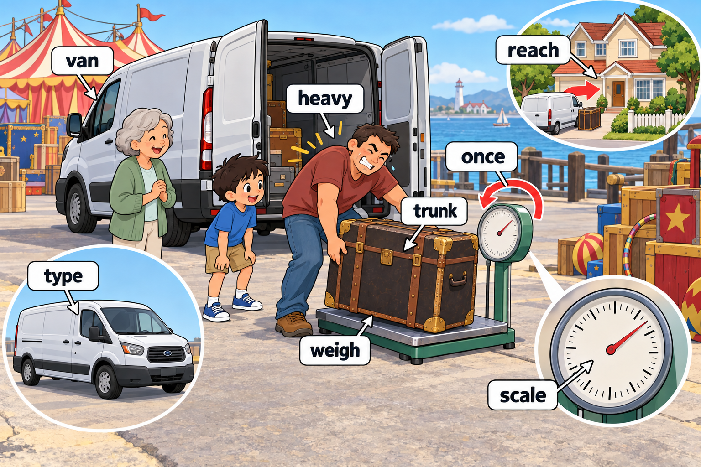

# Story 004 — The Market and the Seaside Circus

中文标题：集市和海边马戏团

范围：**第 4 周（推定） · Day 21–27** · 28 个目标词 · 5 个场景。周次依据见 [words.md](../words.md)。

先读英文，再用中文核对。每次练习约 5–8 个词，词少的场景可以合并，词多的场景分两次；读完后遮住句子，用动作或自己的话复述。

## Scene 1 — An onion on the run

场景：滚走的洋葱 · 单词来源：Day 21、Day 22

A week **ago**, Miller **stood** on the **curb** beside his toy **wagon**.

It was full of **onions** for the market.

A loose onion rolled away, so Miller had to **chase** it.

中文解释：一周以前，Miller 站在马路牙子上，旁边是装着洋葱的玩具四轮车。一只洋葱滚走了，他赶紧追了过去。

Words used: ago, stood, curb, wagon, onions, chase.

## Scene 2 — Seeds and a snack

场景：种子和点心 · 单词来源：Day 22、Day 23

At the market, a farmer **sold** Miller some cheese shaped like a **cube**.

She gave him a **shovel** and **another** packet of seeds.

“Let us **grow** some onions,” she said.

中文解释：在集市上，一位农场主卖给 Miller 一块立方体形状的奶酪，又给了他一把铲子和另一包种子。她说：“我们种些洋葱吧。”

Words used: sold, cube, shovel, another, grow.

## Scene 3 — A circus by the ocean

场景：海边的马戏团 · 单词来源：Day 21、Day 24

They went to a **circus** on a piece of **land** beside the **ocean**.

A **paddler** splashed through the shallow water.

Miller made a **mistake** and left his ticket in the wagon.

中文解释：他们来到海边一块土地上的马戏团。一位涉水者在浅水中踩出了水花。Miller 发现自己犯了个错误：把票留在四轮车里了。

Words used: circus, land, ocean, paddler, mistake.

## Scene 4 — Waiting with Dad

场景：和爸爸一起等 · 单词来源：Day 25

An **ordered** row of chairs stood **along** the path.

“Do not wait here **alone**,” Grandma said.

“I **care** about you, so stay with Dad.”

中文解释：小路旁的椅子排得整整齐齐。奶奶去取票前说：“不要独自在这里等。我关心你，所以和爸爸待在一起。”

Words used: ordered, along, alone, care.

## Scene 5 — A heavy trunk

场景：沉重的行李箱 · 单词来源：Day 26、Day 27

Miller saw a new **type** of **van** with a **heavy** **trunk** in the back.

“Let us **weigh** it **once** more,” Dad said, while Miller read the **scale** on the dial.

They hoped to **reach** home before dinner.

中文解释：Miller 看见一种新的客货车，车后放着一个沉重的行李箱。爸爸说：“我们再称一次吧。”Miller 看着秤的表盘上的刻度。他们希望晚饭前到家。

Words used: type, van, heavy, trunk, weigh, once, scale, reach.

## Coverage check

按原词表的 Day 和当天序号逐项核对；英文大小写按句子位置调整。

| Week | Day | 当天序号 | 词表单词 | 场景 |
| --- | --- | --- | --- | --- |
| 第 4 周（推定） | 21 | 1 | ago | Scene 1 |
| 第 4 周（推定） | 21 | 2 | wagon | Scene 1 |
| 第 4 周（推定） | 21 | 3 | paddler | Scene 3 |
| 第 4 周（推定） | 21 | 4 | onions | Scene 1 |
| 第 4 周（推定） | 22 | 1 | stood | Scene 1 |
| 第 4 周（推定） | 22 | 2 | curb | Scene 1 |
| 第 4 周（推定） | 22 | 3 | chase | Scene 1 |
| 第 4 周（推定） | 22 | 4 | cube | Scene 2 |
| 第 4 周（推定） | 23 | 1 | another | Scene 2 |
| 第 4 周（推定） | 23 | 2 | shovel | Scene 2 |
| 第 4 周（推定） | 23 | 3 | grow | Scene 2 |
| 第 4 周（推定） | 23 | 4 | sold | Scene 2 |
| 第 4 周（推定） | 24 | 1 | ocean | Scene 3 |
| 第 4 周（推定） | 24 | 2 | circus | Scene 3 |
| 第 4 周（推定） | 24 | 3 | land | Scene 3 |
| 第 4 周（推定） | 24 | 4 | mistake | Scene 3 |
| 第 4 周（推定） | 25 | 1 | ordered | Scene 4 |
| 第 4 周（推定） | 25 | 2 | care | Scene 4 |
| 第 4 周（推定） | 25 | 3 | alone | Scene 4 |
| 第 4 周（推定） | 25 | 4 | along | Scene 4 |
| 第 4 周（推定） | 26 | 1 | type | Scene 5 |
| 第 4 周（推定） | 26 | 2 | once | Scene 5 |
| 第 4 周（推定） | 26 | 3 | van | Scene 5 |
| 第 4 周（推定） | 26 | 4 | trunk | Scene 5 |
| 第 4 周（推定） | 27 | 1 | weigh | Scene 5 |
| 第 4 周（推定） | 27 | 2 | heavy | Scene 5 |
| 第 4 周（推定） | 27 | 3 | scale | Scene 5 |
| 第 4 周（推定） | 27 | 4 | reach | Scene 5 |

覆盖结果：28/28 个目标词全部出现。本周没有跨 Day 重复的目标条目；句中为叙事而重复使用的词不新增计数。

## Meaning and language notes

- paddler：这里采用已核对的英式“涉水者”，画浅水中步行的人。
- grow：按词表暂读词形写作 grow，照片原拼写仍待确认；不以本故事反向证明手写词形。
- ordered：这里是形容词“整齐有序的”，没有改成动词“点餐／命令”。更口语的备用句：The chairs stood in a neat row along the path. 学习 ordered 时保留正文句。
- care about you：关心你；along the path：沿着小路。
- trunk：采用词表的“行李箱”，画可搬动的大箱子；没有改成树干或车的后备箱。
- Day 27 的 scale：这里是秤的表盘上的“刻度”，与 Day 10 的 scales 分开。
- ago、once、reach：分别放在 a week ago、once more、reach home 中记忆。

## Recall activities

1. What rolled out of the wagon?（用 onion 回答，并做 chase 的动作。）
2. What does a paddler do here?（说出或演示在浅水里走。）
3. Why did Dad want to weigh the trunk?（用 heavy 回答，再指出 scale。）

4. 选两个目标词，各造一个与 Miller 自己生活有关的新句子。
5. 首次练习后第 1、3、7、14 天复习，先回忆再看答案；在 [review-log.md](review-log.md) 中记录。
