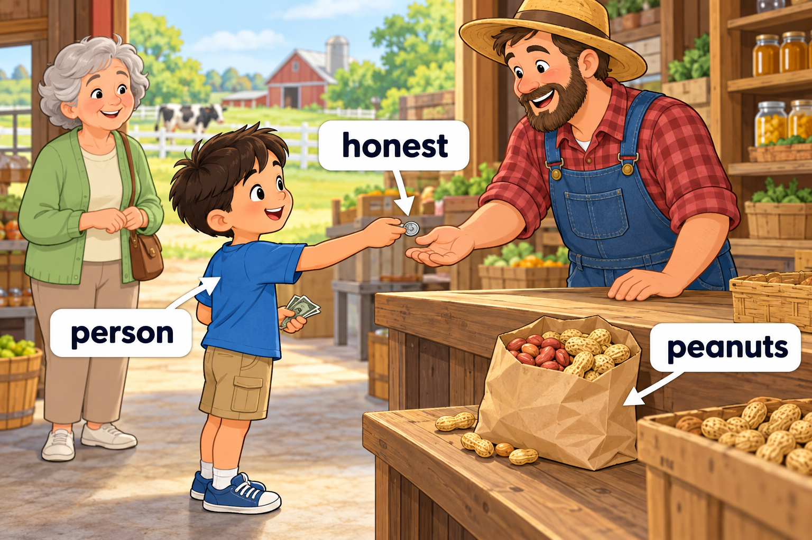
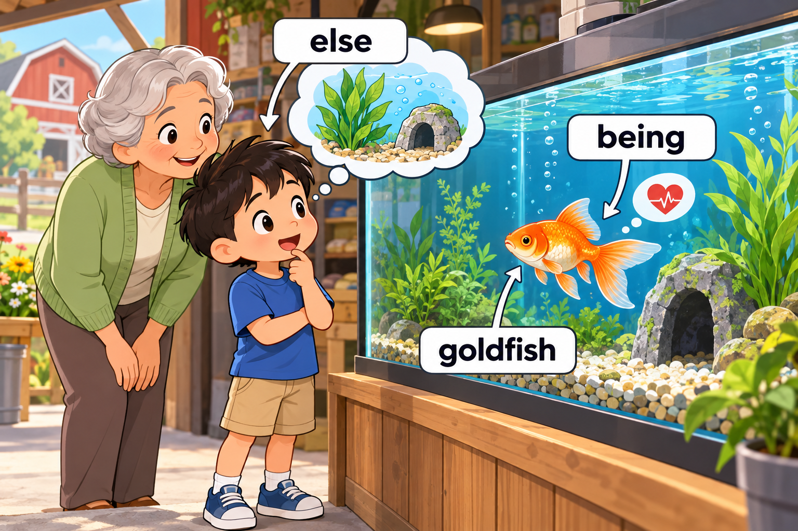
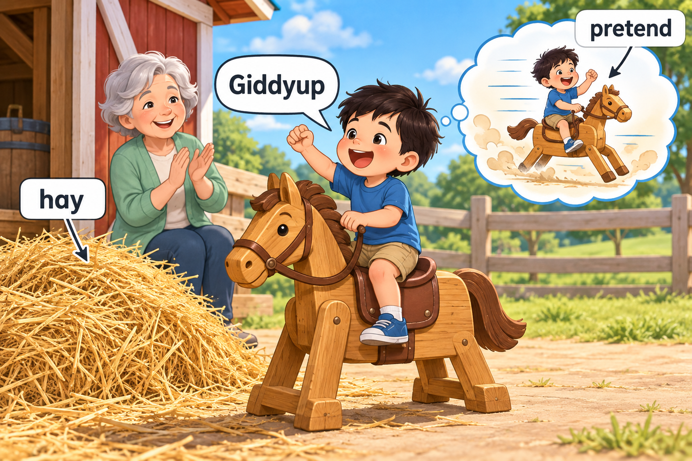
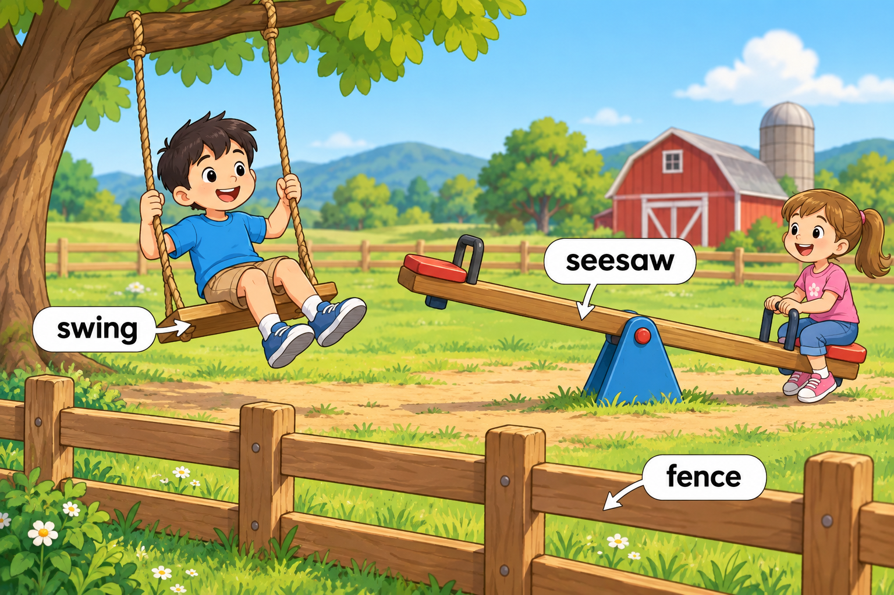

# Story 005 — A Kind Day at the Farm

中文标题：农场里友善的一天

范围：**第 5 周（推定） · Day 28–30** · 12 个目标词 · 4 个场景。周次依据见 [words.md](../words.md)。

先读英文，再用中文核对。每次练习约 5–8 个词，词少的场景可以合并，词多的场景分两次；读完后遮住句子，用动作或自己的话复述。

## Scene 1 — An honest person

场景：诚实的人 · 单词来源：Day 28

“You are an **honest** **person**,” the farmer said when Miller returned a lost coin.

Then Miller bought some **peanuts** with his own money.

中文解释：Miller 把捡到的硬币还给农场主，农场主夸他是个诚实的人。然后，Miller 用自己的钱买了些花生。

Words used: honest, person, peanuts.

## Scene 2 — A living being

场景：有生命的小伙伴 · 单词来源：Day 28、Day 29

Beside the shop, Miller watched a **goldfish** swim.

A sign said, “Every living **being** needs food and water.”

“What **else** does it need?” he asked.

中文解释：小店旁，Miller 看着金鱼游动。牌子上写着：“每一个有生命的个体都需要食物和水。”他问：“它还需要什么呢？”

Words used: goldfish, being, else.

## Scene 3 — Giddyup!

场景：驾！ · 单词来源：Day 29、Day 30

There was a pile of **hay** beside a wooden horse.

“Let us **pretend** it can run,” Miller said.

“**Giddyup**!” he called from the saddle.

中文解释：木马旁有一堆干草。Miller 说：“我们假装它能跑吧。”他坐在马鞍上喊：“驾！”

Words used: hay, pretend, Giddyup.

## Scene 4 — One last game

场景：最后再玩一会儿 · 单词来源：Day 30

Behind a low **fence**, Miller found a **swing** and a **seesaw**.

He tried them both before going home.

中文解释：矮栅栏后面有一个秋千和一个跷跷板。Miller 都玩了一会儿，然后回家了。

Words used: fence, swing, seesaw.

## Coverage check

按原词表的 Day 和当天序号逐项核对；英文大小写按句子位置调整。

| Week | Day | 当天序号 | 词表单词 | 场景 |
| --- | --- | --- | --- | --- |
| 第 5 周（推定） | 28 | 1 | peanuts | Scene 1 |
| 第 5 周（推定） | 28 | 2 | being | Scene 2 |
| 第 5 周（推定） | 28 | 3 | honest | Scene 1 |
| 第 5 周（推定） | 28 | 4 | person | Scene 1 |
| 第 5 周（推定） | 29 | 1 | goldfish | Scene 2 |
| 第 5 周（推定） | 29 | 2 | else | Scene 2 |
| 第 5 周（推定） | 29 | 3 | pretend | Scene 3 |
| 第 5 周（推定） | 29 | 4 | hay | Scene 3 |
| 第 5 周（推定） | 30 | 1 | giddyup | Scene 3 |
| 第 5 周（推定） | 30 | 2 | fence | Scene 4 |
| 第 5 周（推定） | 30 | 3 | swing | Scene 4 |
| 第 5 周（推定） | 30 | 4 | seesaw | Scene 4 |

覆盖结果：12/12 个目标词全部出现。本周没有跨 Day 重复的目标条目；句中为叙事而重复使用的词不新增计数。

## Meaning and language notes

- peanuts：这里选择食物“花生”，没有使用漫画标题的意思。
- being：这里作为名词，用在 living being（有生命的个体／生灵）中。词表原记“存在”；该单词在本故事中的具体用法单独注明。
- else：在 What else...? 中表示“还／其他”。
- giddyup：催马前进的感叹词，句首按英文书写习惯大写。
- fence：使用用户已确认的标准拼写；标签也应使用 fence。

## Recall activities

1. Why was Miller an honest person?（复述他归还硬币的动作。）
2. What does a living being need?（说出 food 和 water。）
3. What did Miller find behind the fence?（说出 swing 和 seesaw。）

4. 选两个目标词，各造一个与 Miller 自己生活有关的新句子。
5. 首次练习后第 1、3、7、14 天复习，先回忆再看答案；在 [review-log.md](review-log.md) 中记录。
